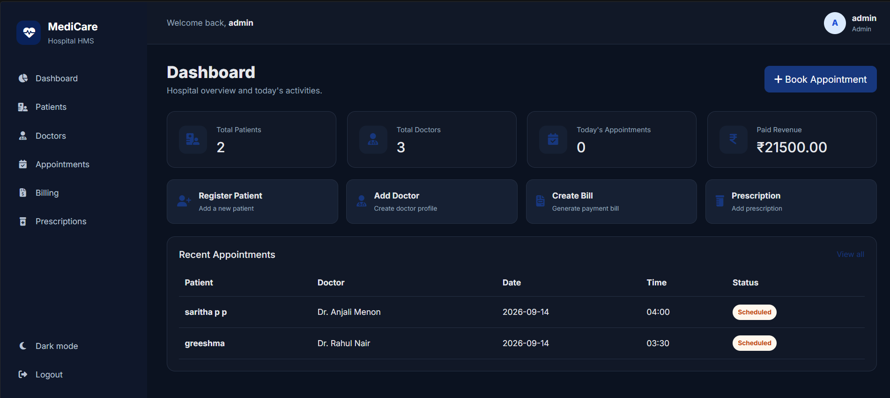
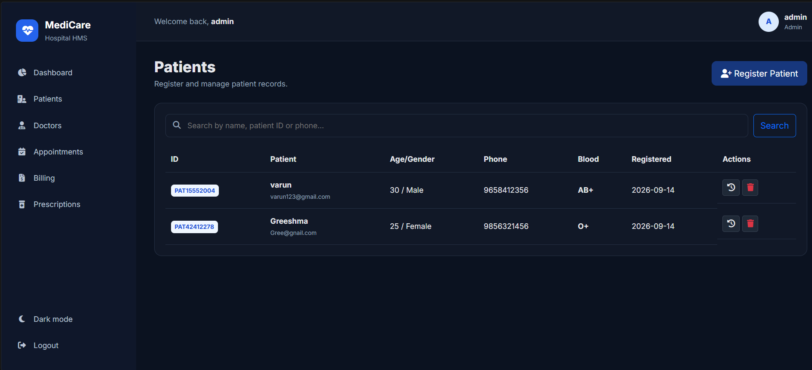
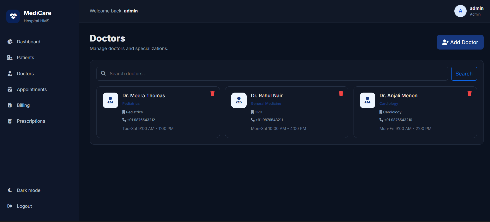
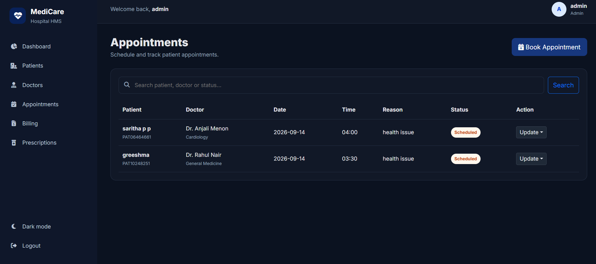
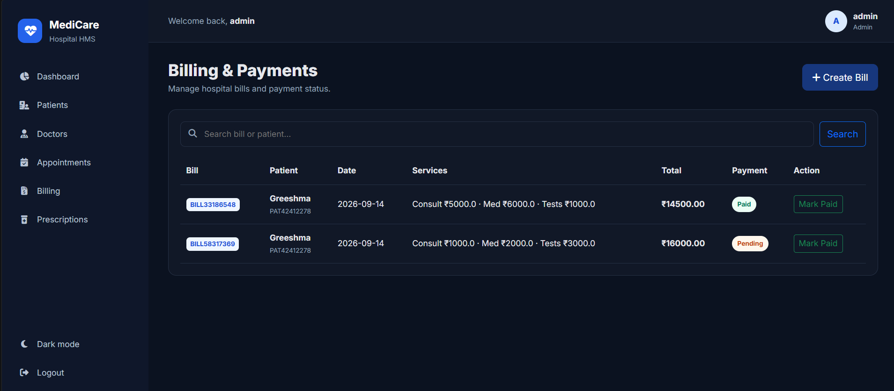

# Hospital Management System

Live Demo: [https://github.com/greexhma/Hospital-Management-System#hospital-management-system](https://greexhma.github.io/MediCare-Hospital-Management-System/)

A modern and responsive Hospital Management System built using Python, Flask, SQLite, HTML, CSS, and JavaScript. This application helps manage hospital operations such as patient records, doctor details, appointments, billing, prescriptions, and medical history.

---

## 🚀 Features

- 🏥 Attractive hospital dashboard
- 👤 Patient registration and management
- 👨‍⚕️ Doctor management
- 📅 Appointment booking and management
- 💰 Billing and payment management
- 💊 Prescription management
- 📋 Patient medical history
- 🔎 Search functionality
- 🔐 Admin login and logout
- 🌙 Dark mode
- 📱 Responsive design
- 🗄️ SQLite database integration
- 📊 Dashboard statistics
- 🔄 Appointment status management
- 💵 Automatic billing calculation

---

## 🛠️ Technologies Use

- Python
- Flask
- SQLite
- HTML5
- CSS3
- JavaScript
- Bootstrap 5
- Font Awesome
- Jinja2

---

## 📌 How It Works

1. Admin logs into the Hospital Management System
2. Admin accesses the hospital dashboard
3. Patients can be registered and managed
4. Doctors can be added with their specialization and availability
5. Appointments can be booked for patients
6. Appointment status can be updated
7. Hospital bills can be generated
8. Payment status can be managed
9. Prescriptions can be added for patients
10. Patient medical history can be recorded and viewed

---

## 📷 Screenshots

### 🖥️ Dashboard

Add your dashboard screenshot here:



### 👤 Patient Management



### 👨‍⚕️ Doctor Management



### 📅 Appointment Management



### 💰 Billing




---

## 📂 Project Structure

[svg](https://github.com/greexhma/Hospital-Management-System#-project-structure)

```text
Hospital-Management-System/
│
├── app.py
├── hospital.db
├── requirements.txt
├── README.md
│
├── templates/
│   ├── base.html
│   ├── login.html
│   ├── dashboard.html
│   ├── patients.html
│   ├── add_patient.html
│   ├── doctors.html
│   ├── add_doctor.html
│   ├── appointments.html
│   ├── add_appointment.html
│   ├── billing.html
│   ├── add_bill.html
│   ├── prescriptions.html
│   ├── add_prescription.html
│   └── history.html
│
└── static/
    ├── css/
    │   └── style.css
    │
    └── js/
        └── script.js
